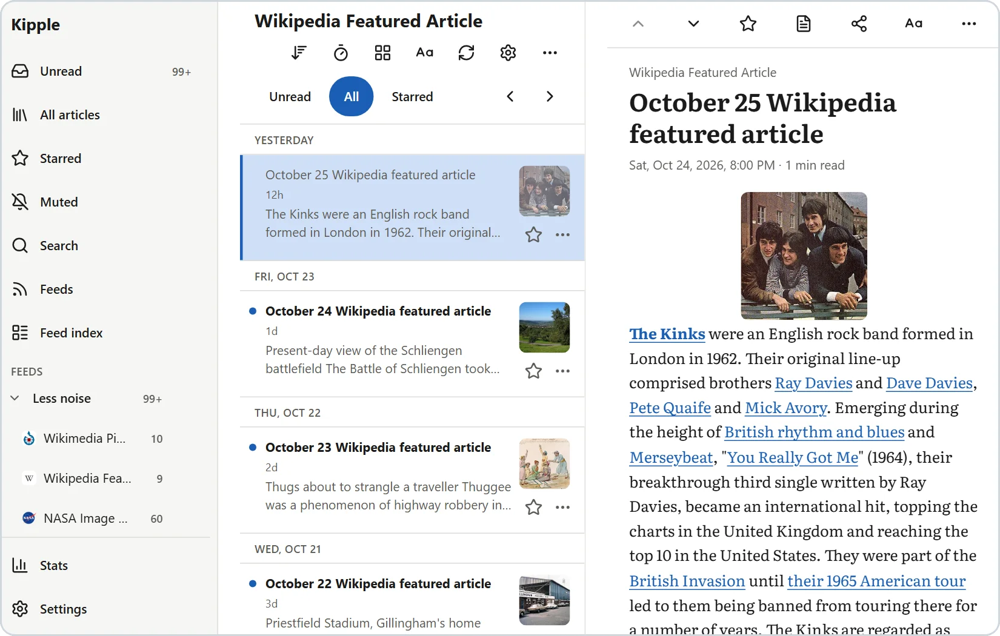
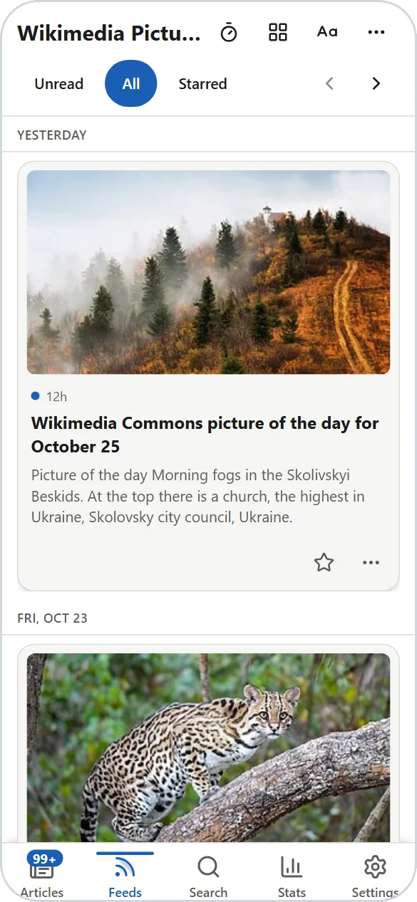

# Kipple

> *When nobody's around, kipple reproduces itself.*
>
> Philip K. Dick, *Do Androids Dream of Electric Sheep?* (1968)

A self-hosted RSS reader you run yourself: a web app plus a Google Reader compatible sync API, in a single container.

[](https://github.com/WPTK/Kipple/actions/workflows/ci.yml)
[](https://github.com/WPTK/Kipple/releases)
[](LICENSE)
[](https://github.com/WPTK/Kipple/pkgs/container/kipple)

<table>
  <tr>
    <td width="560" align="center" valign="bottom">
      <picture>
        <source media="(prefers-color-scheme: dark)" srcset="docs/screenshots/desktop-dark.webp">
        
      </picture>
    </td>
    <td width="170" align="center" valign="bottom">
      <picture>
        <source media="(prefers-color-scheme: dark)" srcset="docs/screenshots/phone-dark.webp">
        
      </picture>
    </td>
  </tr>
  <tr>
    <td width="560" align="center"><sub>Web app</sub></td>
    <td width="170" align="center"><sub>Phone</sub></td>
  </tr>
</table>

## Features

- Layouts, color themes (separate day and night picks) and reading fonts. Set a layout per device, folder or feed.
- Nested folders. OPML import and export.
- Search, saved searches, and keyword filters that mute, star, highlight or mark articles read.
- Per-feed retention from 50 articles to unlimited. Starred articles are never deleted.
- Installs as a phone app from your browser (needs HTTPS, see the [reverse proxy guide](docs/reverse-proxy.md)). Opened articles read offline.
- Syncs with any app that speaks the Google Reader API.
- Reading stats and a yearly summary (Your year), stored in your own database.
- Backup and restore in Settings, plus a nightly snapshot. Backups contain credentials (password hashes, the account secret and feed logins), so keep them private.

## Install

Replace `<version>` with a tag from the [releases page](https://github.com/WPTK/Kipple/releases). `latest` follows the newest stable release.

```
docker run -d --name kipple --restart unless-stopped -p 127.0.0.1:1919:1919 -v kipple_data:/data ghcr.io/wptk/kipple:<version>
```

This is the short form. The hardened form (read-only, no capabilities) and compose files are in the [deploy guide](docs/deploy.md).

Open <http://127.0.0.1:1919> to create the account, or restore a backup from another Kipple.

- The port is published on `127.0.0.1` only. For other devices use HTTPS through a reverse proxy
  ([guide](docs/reverse-proxy.md)) or a private network such as Tailscale, never plain http.
- Until the account exists, anyone who can reach the port can claim it.
- An instance with no password is for localhost or a private network only. Anyone who can reach it has full access.

See the [threat model](docs/threat-model.md).

The [deploy guide](docs/deploy.md) covers other machines (SSH tunnel), backups, upgrades, verifying the image signature and building from source.

## Sync with other apps

Add a Google Reader compatible account in your sync app:

- Server: your Kipple address plus `/api/greader.php`
- User name: the name you chose during setup
- Password: an app password, separate from your web password. Create it in the last setup step or under
  Settings, Account & Devices, Generate new app password. Kipple shows it once.

## What Kipple leaves out

- Podcasts, audio and video players. Media links in articles still open.
- Webhooks and other integrations with outside services.
- Tags. Feeds live in folders, and articles can be starred.
- AI features.
- Notifications.
- Social features. The web app can still share an article through your device's share sheet or copy its link.
- Monitoring or analytics.\*
- Multiple users.

\* _Reading statistics stay in your own database and are never sent anywhere._

## Documentation

- [Changelog](CHANGELOG.md)
- [Deploy guide](docs/deploy.md): quick start, install options, ports, backups, restore, upgrades, Cloudflare Access.
- [Reverse proxy](docs/reverse-proxy.md): HTTPS with Caddy, nginx or Traefik.
- [Troubleshooting](docs/troubleshooting.md)
- [Threat model](docs/threat-model.md): what Kipple protects and how to run it safely.
- [Compatibility](docs/compatibility.md): what stays the same across 1.x, and the Reader API in detail.
- [Design](docs/design.md): how Kipple works inside.
- [Performance](docs/performance.md): 500 feeds and 150,000 articles, measured.
- [All docs](docs/README.md)

To report a bug, open an [issue](https://github.com/WPTK/Kipple/issues). To send a change, read
[CONTRIBUTING.md](CONTRIBUTING.md). Vulnerabilities go through [SECURITY.md](SECURITY.md).

## Maintenance

Most code, tests and docs are written by AI coding agents (Claude) and checked by CI scans, fuzzing, and signed, attested
releases with an SBOM. A single maintainer. [SECURITY.md](SECURITY.md) sets a 14-day target for a first response. The code is under a permissive
license, and a fork builds and signs its own releases. You can [verify a release](docs/deploy.md#verify-the-signature).
Notes and decisions are on the [maintainer's blog](https://blog.wptk.org) and in the
[history repository](https://github.com/WPTK/kipple-history).

## License

[Blue Oak Model License 1.0.0](LICENSE): use, modify and share it, including commercially. Third-party licenses are in
[THIRD_PARTY_NOTICES.md](THIRD_PARTY_NOTICES.md).
